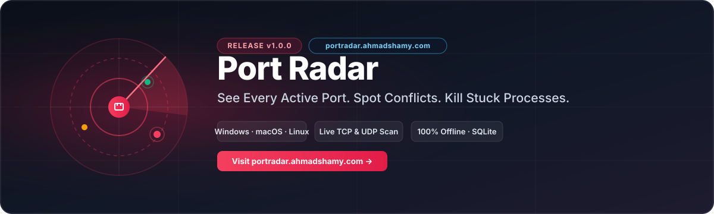
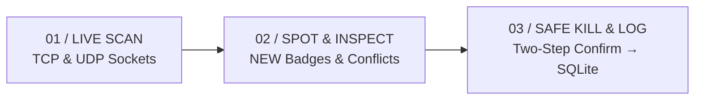

<div align="center">

[](https://portradar.ahmadshamy.com/)

<br/>

[](https://portradar.ahmadshamy.com/)
[](https://github.com/dreadPaiertDavincci/port-radar/releases/latest)
[](#download)
[](#privacy--storage)

**A lightweight desktop monitor for inspecting live TCP/UDP ports, tracking watched development ports, detecting multi-process conflicts, and safely terminating blocking processes.**

[**🌐 Official Website**](https://portradar.ahmadshamy.com/) · [**⬇️ Download Latest Release**](https://github.com/dreadPaiertDavincci/port-radar/releases/latest) · [**⚡ Terminal Quick Install**](#terminal-quick-install) · [**📦 All Releases**](https://github.com/dreadPaiertDavincci/port-radar/releases)

</div>

> [!TIP]
> **Official Website:** [**https://portradar.ahmadshamy.com/**](https://portradar.ahmadshamy.com/) — Explore interactive screenshots, feature walkthroughs, FAQs, and one-click downloads for Windows, macOS, and Linux.

---

## Download

Choose the installer or package for your operating system and architecture (**v1.0.0**):

| Platform | Architecture | Format | Download |
| :--- | :--- | :--- | :--- |
| **Windows 10 / 11** | `x64` (64-bit) | Setup Wizard `.exe` *(Desktop Shortcut)* | [PortRadar-v1.0.0-win-x64.exe](https://github.com/dreadPaiertDavincci/port-radar/releases/download/v1.0.0/PortRadar-v1.0.0-win-x64.exe) |
| **Windows 10 / 11** | `x86` (32-bit) | Setup Wizard `.exe` *(Desktop Shortcut)* | [PortRadar-v1.0.0-win-x86.exe](https://github.com/dreadPaiertDavincci/port-radar/releases/download/v1.0.0/PortRadar-v1.0.0-win-x86.exe) |
| **Windows 10 / 11** | `ARM64` | Portable `.zip` | [PortRadar-v1.0.0-win-arm64.zip](https://github.com/dreadPaiertDavincci/port-radar/releases/download/v1.0.0/PortRadar-v1.0.0-win-arm64.zip) |
| **macOS 13+** | Apple Silicon (`M1–M4`) | Installer Wizard `.pkg` | [PortRadar-v1.0.0-osx-arm64.pkg](https://github.com/dreadPaiertDavincci/port-radar/releases/download/v1.0.0/PortRadar-v1.0.0-osx-arm64.pkg) |
| **macOS 13+** | Apple Silicon (`M1–M4`) | Disk Image `.dmg` | [PortRadar-v1.0.0-osx-arm64.dmg](https://github.com/dreadPaiertDavincci/port-radar/releases/download/v1.0.0/PortRadar-v1.0.0-osx-arm64.dmg) |
| **macOS 13+** | Intel (`x64`) | Installer Wizard `.pkg` | [PortRadar-v1.0.0-osx-x64.pkg](https://github.com/dreadPaiertDavincci/port-radar/releases/download/v1.0.0/PortRadar-v1.0.0-osx-x64.pkg) |
| **macOS 13+** | Intel (`x64`) | Disk Image `.dmg` | [PortRadar-v1.0.0-osx-x64.dmg](https://github.com/dreadPaiertDavincci/port-radar/releases/download/v1.0.0/PortRadar-v1.0.0-osx-x64.dmg) |
| **Linux (Ubuntu / Debian)** | `x64` (`amd64`) | `.deb` Package *(Menu + Desktop Icon)* | [PortRadar-v1.0.0-linux-x64.deb](https://github.com/dreadPaiertDavincci/port-radar/releases/download/v1.0.0/PortRadar-v1.0.0-linux-x64.deb) |
| **Linux (Universal)** | `x64` | `.AppImage` | [PortRadar-v1.0.0-linux-x64.AppImage](https://github.com/dreadPaiertDavincci/port-radar/releases/download/v1.0.0/PortRadar-v1.0.0-linux-x64.AppImage) |
| **Linux** | `x64` | `.tar.gz` Archive | [PortRadar-v1.0.0-linux-x64.tar.gz](https://github.com/dreadPaiertDavincci/port-radar/releases/download/v1.0.0/PortRadar-v1.0.0-linux-x64.tar.gz) |
| **Linux** | `ARM64` | `.tar.gz` Archive | [PortRadar-v1.0.0-linux-arm64.tar.gz](https://github.com/dreadPaiertDavincci/port-radar/releases/download/v1.0.0/PortRadar-v1.0.0-linux-arm64.tar.gz) |

---

## Terminal Quick Install

Download and install Port Radar directly from your terminal:

### Windows (PowerShell)

**Via WinGet (submitted to `microsoft/winget-pkgs`):**
```powershell
winget install PortWatch.PortRadar
```

<details>
<summary>Direct PowerShell Install (x64 / x86 / ARM64)</summary>

**Windows x64 (64-bit Installer):**
```powershell
$url = "https://github.com/dreadPaiertDavincci/port-radar/releases/download/v1.0.0/PortRadar-v1.0.0-win-x64.exe"
Invoke-WebRequest -Uri $url -OutFile "$env:TEMP\PortRadar-Setup.exe"
Start-Process "$env:TEMP\PortRadar-Setup.exe"
```

**Windows x86 (32-bit Installer):**
```powershell
$url = "https://github.com/dreadPaiertDavincci/port-radar/releases/download/v1.0.0/PortRadar-v1.0.0-win-x86.exe"
Invoke-WebRequest -Uri $url -OutFile "$env:TEMP\PortRadar-Setup-x86.exe"
Start-Process "$env:TEMP\PortRadar-Setup-x86.exe"
```

**Windows ARM64 (Portable ZIP):**
```powershell
$url = "https://github.com/dreadPaiertDavincci/port-radar/releases/download/v1.0.0/PortRadar-v1.0.0-win-arm64.zip"
Invoke-WebRequest -Uri $url -OutFile "$env:TEMP\PortRadar-arm64.zip"
Expand-Archive "$env:TEMP\PortRadar-arm64.zip" -DestinationPath "$env:LOCALAPPDATA\PortRadar" -Force
Start-Process "$env:LOCALAPPDATA\PortRadar\PortWatch.exe"
```

</details>

---

### Linux (One-Line Auto-Installer)

Automatically detects your distro & architecture (`.deb` on Ubuntu/Debian, `.AppImage` on Fedora/Arch, `.tar.gz` on ARM64):
```bash
curl -fsSL \
  https://raw.githubusercontent.com/dreadPaiertDavincci/port-radar/main/packaging/linux/install.sh \
  | bash
```

<details>
<summary>Manual Linux Commands (.deb / .AppImage / .tar.gz)</summary>

**Ubuntu / Debian (`.deb` Package):**
```bash
curl -L -o /tmp/PortRadar.deb \
  "https://github.com/dreadPaiertDavincci/port-radar/releases/download/v1.0.0/PortRadar-v1.0.0-linux-x64.deb"
sudo apt install -y /tmp/PortRadar.deb
```

**Any Linux Distro — Universal `.AppImage` (`x64`):**
```bash
curl -L -o PortRadar.AppImage \
  "https://github.com/dreadPaiertDavincci/port-radar/releases/download/v1.0.0/PortRadar-v1.0.0-linux-x64.AppImage"
chmod +x PortRadar.AppImage
./PortRadar.AppImage
```

**Linux `x64` Archive (`.tar.gz`):**
```bash
mkdir -p ~/portradar
curl -L "https://github.com/dreadPaiertDavincci/port-radar/releases/download/v1.0.0/PortRadar-v1.0.0-linux-x64.tar.gz" \
  | tar -xz -C ~/portradar
chmod +x ~/portradar/PortWatch && ~/portradar/PortWatch
```

**Linux `ARM64` Archive (`.tar.gz`):**
```bash
mkdir -p ~/portradar
curl -L "https://github.com/dreadPaiertDavincci/port-radar/releases/download/v1.0.0/PortRadar-v1.0.0-linux-arm64.tar.gz" \
  | tar -xz -C ~/portradar
chmod +x ~/portradar/PortWatch && ~/portradar/PortWatch
```

</details>

---

### macOS (Terminal)

**Apple Silicon (`M1–M4`) — `.pkg` Installer:**
```bash
curl -L -o /tmp/PortRadar.pkg \
  "https://github.com/dreadPaiertDavincci/port-radar/releases/download/v1.0.0/PortRadar-v1.0.0-osx-arm64.pkg"
sudo installer -pkg /tmp/PortRadar.pkg -target /
```

**Intel Mac (`x64`) — `.pkg` Installer:**
```bash
curl -L -o /tmp/PortRadar.pkg \
  "https://github.com/dreadPaiertDavincci/port-radar/releases/download/v1.0.0/PortRadar-v1.0.0-osx-x64.pkg"
sudo installer -pkg /tmp/PortRadar.pkg -target /
```

> **Gatekeeper note:** If macOS asks for verification on first launch, right-click **Port Radar.app** → **Open**, or run:
> ```bash
> xattr -cr "/Applications/Port Radar.app"
> ```

---

## How It Works



---

## Platform Details & Native Engines

Port Radar ships as a self-contained `.NET 10` + `Avalonia UI` desktop application with native OS inspection on every platform:

- **Windows (`10 / 11`):** Live `netstat` + IP Global Properties socket scanning, full executable path resolution via Win32 `QueryFullProcessImageName`, UAC-elevated process termination, and a modern Setup Wizard with desktop shortcut creation.
- **macOS (`13 Ventura+`):** Native `lsof` TCP/UDP port & PID inspection, `ps` process path resolution, and `.pkg` / `.dmg` distribution for both Apple Silicon and Intel Macs.
- **Linux (`Ubuntu · Debian · Fedora · Arch`):** Fast `ss` and `/proc` socket inspection, `/proc/<pid>/exe` path lookup, `.deb` package with desktop integration, `.AppImage`, and `.tar.gz` archives.

---

## Key Features

- **Live TCP & UDP Monitoring:** Port, Protocol, State, IPv4/IPv6 addresses, Process Name, and PID with non-jumping in-place table updates (`1–60s` configurable auto-refresh).
- **Smart Conflict Detection:** Flags ports shared by multiple PIDs with a `Conflict (N PIDs)` badge and dedicated filter.
- **Watched Ports Dashboard:** Pin key ports (`3000`, `5432`, `8080`, etc.) to local SQLite and track `Free`, `In Use`, or `Conflict` status.
- **Newest First Sorting:** Newly opened ports and launched processes rise to the top with a `NEW` badge.
- **Two-Step Safe Kill:** Inline `Kill Process → Confirm Kill` bar prevents accidental process termination.
- **Light & Dark Themes:** Instant theme switching with persistent settings.

---

## Privacy & Storage

- **100% Offline:** Zero telemetry, zero analytics, zero background network calls (aside from optional manual/startup update checks against `version.json`).
- **Local SQLite Database:** Watched ports, preferences, and terminated process history are stored locally on your machine in `portwatch.db`.

---

<div align="center">
<sub>© 2026 <a href="https://portradar.ahmadshamy.com/">Port Radar</a> (PortWatch) · Built with .NET 10, Avalonia UI &amp; SQLite</sub>
</div>
